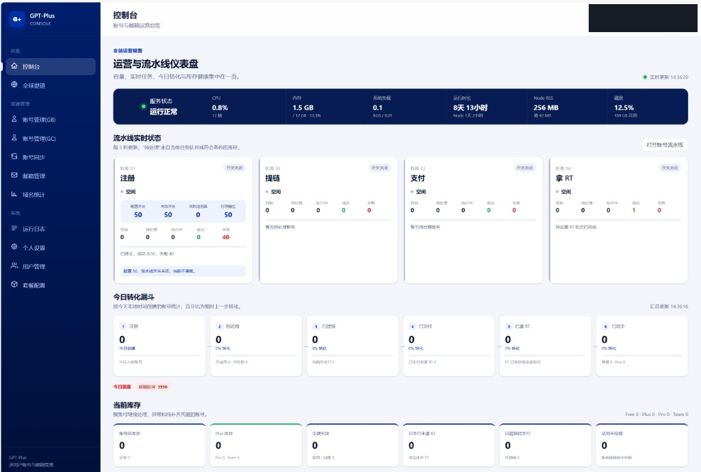
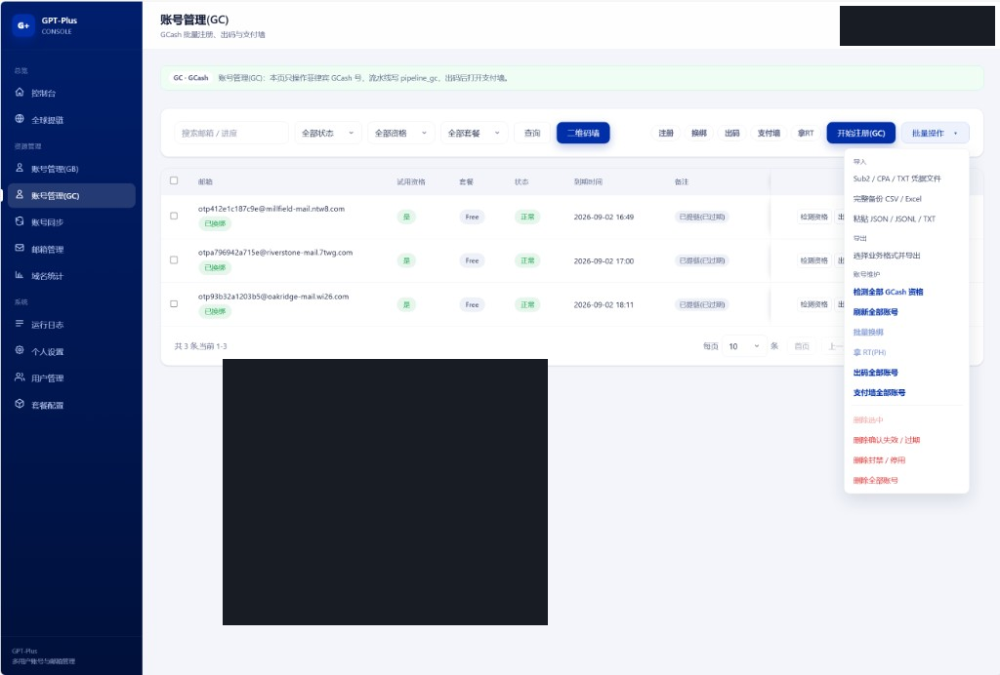
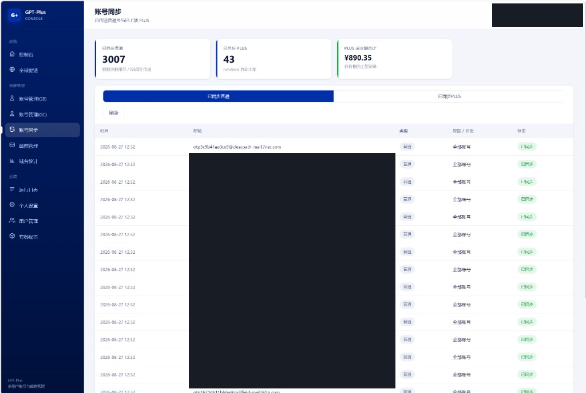

# GPT-Plus

GPT-Plus 是一套多用户 GPT 账号注册机与邮箱运营控制台。它把批量注册、邮箱供给、账号维护和结果同步放在同一套界面里，并按用户隔离资源、按套餐限制额度。

- 开源地址：[github.com/432539/gpt-plus](https://github.com/432539/gpt-plus)
- 交流：QQ 群 **1109037692**

登录页、侧栏和「个人设置 → 账户信息」展示同一开源地址和 QQ 群。

## 功能

### 注册机

注册机按通道运行，并在控制台里连成一条流水线。

| 通道 | 作用 |
| --- | --- |
| 账号管理（GB） | PayPal 方向的批量注册、导入导出与账号维护 |
| 账号管理（GC） | GCash 方向的批量注册、出码与支付墙 |

流水线分为四段：注册、提链、支付、获取 Refresh Token。控制台展示每段的队列、成功和失败，以及当天从注册到同步的转化。邮箱来源在设置中切换，可选自建 Mailpit、mail.com 子号和 Cloudflare 域名邮箱。

### 邮箱与域名

母号和子号分开管理，后缀可以逐个启用、停用，并设置每小时、每天的额度。域名统计按邮箱后缀汇总注册、试用和支付的成功率，用来判断哪些域名还能继续用。

### 账号运营

账号列表支持筛选、验活、导入导出和批量操作。账号同步记录已经传送的普通号，以及已经上架的 Plus 和对应成交额。运行日志保留拉子号、注册、提链和开通的过程，便于回看失败发生在哪一段。

### 多用户

管理员配置用户、套餐等级，以及账号和邮箱的限额。每个用户的密钥类设置加密保存在本地数据库中，接口只返回是否已经配置，不回显明文。

## 界面

### 控制台

运营仪表盘集中显示服务状态、四段流水线和当日转化。



### 账号管理（GC）

GCash 通道的账号列表。注册、资格检测和批量操作都从这里进入。



### 账号同步

已同步普通号与已上架 Plus 的汇总。



## 本地运行

需要 Node.js。首次启动会创建管理员 `admin` / `admin123`，登录后请立即修改密码。

```bash
cp .env.example .env
npm run install:all
npm run dev:server
npm run dev:web
```

字段说明见 [docs/CONFIG.md](docs/CONFIG.md)。

## 公开仓库约定

本仓库提供脱敏后的公开源码。服务器地址、邮箱域名、API Key、License、代理账号和数据库都不写入代码，请在本机 `.env` 和设置页填写。不要提交 `.env`、`server/data` 或浏览器运行时目录。部署脚本只从环境变量读取主机。
